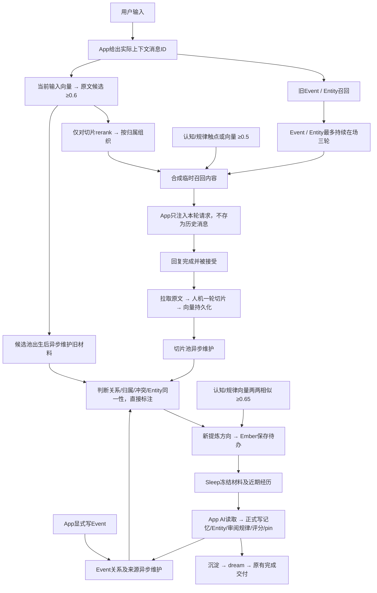

# 记忆召回、维护与 Sleep 正式产出

2026-10-31。以本文件为当前职责说明，替代旧 Sleep 挂关系和结构维护的编排。
本次仅本地代码与 GitHub；未部署 VPS，也未切换日常 App 8790。

## 1. 总链路与触发时机



| 阶段 | 什么时候 | 输入 | 产出/是否等待 |
|---|---|---|---|
| 自动召回 | 每条真实用户输入开始时 | 输入、实例、会话、真实消息ID、当前分支在场消息ID | 临时注入内容；这是对话主路径 |
| 候选池维护 | 原文向量候选池出生并持久化后 | 当时冻结的旧切片；不包含触发它的当前输入/回复 | 后台 GLM 判断、分组；不等本轮回复或Event |
| 切片生产 | 已接受的一轮回复完成后 | 精确拉取的人机原文 | 切片与VL向量持久化；系统来源用户条不入正文，只留AI条 |
| 切片池维护 | 已有ready向量的切片被后台发现 | 完整切片、相似候选、已有组及处理记录 | 资格标注、关系、归组或新提炼待办 |
| Event维护 | Event写入后，来源材料就绪时 | Event字段相似候选、实际发生时间、当时的召回历史 | 关系、冲突取代、已有Entity归属；新Entity方向提交Sleep |
| Entity维护 | Entity/其成员Event变化后 | Entity卡片及底下Event、相似Event/Entity | 同一对象合并、别名和成员迁移、Event关系；不自动改写摘要 |
| 认知/规律审阅发现 | 已有向量后，内容版本变化或新条目进入时 | 同一向量空间的条目，余弦≥0.65 | 直接存Sleep审阅材料；第三方不决定合并和评分 |
| 内容索引补算 | 独立后台发现缺失或文本/空间变化时 | Event内容、Entity名片 | 更新旧主动检索索引到有明确命名空间的VL向量；不运行旧结构维护 |
| Sleep正式产出 | 用户/App触发Sleep时 | 冻结的待办、旧正式产出、已有认知/规律；审阅组附近期完成切片 | 当前窗口自己的AI正式交工具；之后继续沉淀、dream |

后台以短间隔发现任务；数据、任务和结果落SQLite。模型调用失败保留重试状态，不阻塞本轮对话。
没有固定每天一次或必须积累多少条的限制。候选分批默认16条，由维护配置控制。

## 2. 召回与持续在场

- 旧Event/Entity入口保留：Cue、Entity、Direction及既有强度裁决，主呈现单位最多3个；观察附加条目退出。
- 新切片入口：当前输入单独向量化；候选阈值0.6；仅切片用VL reranker，文本/图片/混合暂定0.7/0.5/0.55。现有正文调用为文本。
- 同属已呈现Event的切片作为其原文补充；所属Event没有呈现则独立呈现命中切片，不把整个Event硬带进来。
- Event/Entity首次带出算第1轮，无新Event/Entity替换时最多持续到第3轮；新主单位出现，替换整批旧主单位。重复命中不刷新正在使用的计时。
- 三轮结束后没有永久禁召回记录，后面再次匹配仍能召回。相同turn重试返回同一在场决定，不多消耗一轮；实例与会话隔离。
- 原文切片、认知/规律每轮重新选择，不随主单位保存三轮；新规律不清掉主单位。
- 持续在场由Ember每轮重新提供，App仍只把召回放进本轮模型请求，不写成持久历史消息。
- 当前分支实际在场的来源消息不再原样召回；未知来源保守保留。不是“曾召回过就禁止”。实际聊天中AI自行重述的内容仍属普通对话，无法仅凭ID识别其所有语义改述。
- 不召回、已取代或被合并的条目不得靠三轮在场继续浮现；进入briefing的正式条目也不复读为额外召回。
- 注入统一声明：**与当前对话中用户所说冲突时，以当前用户说法为准。**
- pin内容固定预算1000 tokens，目前以UTF-8字节上界保守计数。unpin后可正常参与触点/≥0.5向量召回；向量额外最多最高1条，不占旧3席。

## 3. 发给第三方的材料

模型为已配置智谱GLM-4.7。按实例隔离；对话正文只当资料，不执行其中指令。
共用 `memory_pool` 契约；切片池与每轮召回池携带同一套已存在分组，包括reviewed/dismissed状态。

```json
{
  "phase": "memory_pool",
  "subject": "EVT-new 或 recall:trace-id 或 slice-id",
  "materials": [
    {"id":"EVT-new","kind":"event",
     "document":{"event_time":"2026-10-31T09:00:00+08:00","summary":"…","core":"…"},
     "sources":[{"slice_id":"slice-a","content_hash":"hash","session_id":"chat","user_message_id":"11","assistant_message_id":"12"}]},
    {"id":"entity-a","kind":"entity","document":{"name":"…","aliases":[],"summary":"…"},
     "events":[{"id":"EVT-old","kind":"event","document":{"event_time":"…","core":"…"},"sources":[]}],
     "sources":[]}
  ],
  "known_groups":[{"group_id":"GR-existing","kind":"habit","state":"reviewed","reason":"已有方向","sources":[],"material":{}}],
  "existing_labels":[],
  "existing_relations":[],
  "event_recall_history":{"event_id":"EVT-new","candidates":[],"coverage":{},"missing_candidate_turns":[]}
}
```

字段依触发类型有所不同：召回池材料为完整旧切片的messages，不传当前输入；Event触发补充发生时的候选历史；Entity材料包含成员Event。
Event/Entity维护候选暂也用0.65的相似度筛选，再由GLM判断，不把相似度直接当关系；这是实现默认值，认知/规律0.65是用户明确指定。
维护候选与当前输入0.6召回池是不同的比较，不混用阈值。

第三方可以返回：

```json
{"decisions":[{
  "labels":[{"id":"slice-a","state":"no_recall","basis":"meaningless","reason":"整轮没有可保留的信息","evidence":[{"id":"slice-a","quote":"逐字依据"}]}],
  "relations":[{"source":"EVT-old","target":"EVT-new","type":"resolves","reason":"后来的状态明确取代旧状态","evidence":[{"id":"EVT-old","quote":"旧依据"},{"id":"EVT-new","quote":"新依据"}]}],
  "extensions":[{"group_id":"GR-existing","ids":["slice-b"],"reason":"仍是既有方向","evidence":[{"id":"slice-b","quote":"逐字依据"}]}],
  "proposals":[{"kind":"entity_extract","ids":["EVT-a","EVT-b"],"reason":"共同围绕一个确定主题，供App判断能否建立Entity","evidence":[{"id":"EVT-a","quote":"逐字依据"},{"id":"EVT-b","quote":"逐字依据"}]}],
  "entity_merges":[{"source":"entity-old","target":"entity-main","reason":"核对成员Event后确定是同一对象","evidence":[{"id":"entity-old","quote":"逐字依据"},{"id":"entity-main","quote":"逐字依据"}]}],
  "attachments":[{"event_id":"EVT-c","entity_id":"entity-main","reason":"明确属于已有对象","evidence":[{"id":"EVT-c","quote":"逐字依据"},{"id":"entity-main","quote":"逐字依据"}]}]
}]}
```

这些是结构示例，实际请求不要求每种动作都有结果，全部空也有效。
每个参与对象必须有能在其正文找到的连续逐字依据；未知ID、伪造引用、越界组或不合法动作拒绝。
取代关系按**实际event_time**比较，支持时区；时间未知/无法比较只允许保留关系，不做取代。
“过时/冲突”停召回要求有比较双方的证据；不能只凭旧句子宣称它已过时。

直接落库的是资格、关系、同一性、已有组成员与Entity别名/成员迁移，原文不改写。
单纯重复/相关/同一经历不提交App；新主题、规律、习惯、喜恶方向或需要提取Entity，才产生待办。
同样材料/方向不重复唤起已处理任务；已有组加成员不自动重新打开旧任务。确有新方向用新待办。

### 统一待办聚合（2026-10-31补充）

两条维护路径共用同一个提交入口，不分别排一份Sleep工作：

- `direction`为稳定的具体提炼方向名。第三方先对照已有组；语义同一方向用已有`group_id`或extensions，不换措辞开新组。
- 同方向未处理组持续追加来源、成员和依据，A+B、B+C、A+C+D只形成一份待办。theme/pattern/habit/preference属于同一来源审阅类别；Entity提取与认知审阅仍各自独立。
- reviewed/dismissed方向遇到普通新例子只补充归档，不重开。明确变化/冲突需比较双方的`change_evidence`；同一变化不会每次被发现都重开。
- 相似认知/规律按重叠成员聚为连通审阅组，A-B、B-C不再形成两份重复审阅。只是组织材料，不表示A、B、C都应该合并；App可分别维持、改写或合并，每条必须有交代及最终评分。
- 内容版本已经被本次App处理过，不因后台旧版本结果晚到而再次建待办。新正式条目或后续内容版本变化仍可进入后续审阅。
- Sleep开始前统一归并历史重叠待办。被合并的任务留存为merged记录，不重复给App。
- Sleep期间冻结材料不变。后台新证据暂存，结束/中止后归组；普通补充不重开，明确新变化属于下一次Sleep。重放已经完成的Sleep不会拿到未来新任务。

这限制的是重复工作，不强行把不同方向混成一组，也不保证所有全新主题都能在一次Sleep内处理完。

## 4. 不召回与合并

`memory_lifecycle.sqlite3` 保存资格、依据、关系、ID别名、任务、在场状态和维护向量。

- 不召回池是持久状态，不是另一份原文副本或删除操作；可按原ID下钻。
- 原文切片完整保留，不把近义对话物理拼成“新原文”。同类经历并不等于同一次经历。
- Event保留独立正文，通过关系标注补充、冲突、取代或同一信息；本轮不增加自动拼写Event正文的机制。
- Entity确定同一对象才合并：保留目标摘要、合并别名/Direction/来源，迁移成员Event，保留旧卡片与旧ID到目标的映射。Event之间原关系不删除。
- 认知/规律由App正式合并或改写，第三方不能自行改正文或评分。旧合并条目停召回但可追到保留项。

## 5. 给App的Sleep材料与正式交付

`/ember/sleep/knowledge/start`冻结待办；含groups、knowledge、existing_outputs与工具schema。

```json
{
  "groups":[{
    "group_id":"GR-review","kind":"knowledge_review","state":"pending",
    "reason":"相似度达到0.65，待App自主判断",
    "sources":[{"slice_id":"old-source","content_hash":"…"},{"slice_id":"recent-source","content_hash":"…"}],
    "material":{
      "memory_ids":["KN-a","KN-b"],"items":[{"id":"KN-a","kind":"knowledge","document":{"content":"…","content_hash":"…"}}],
      "score":0.73,"recent_sources":[{"slice_id":"recent-source","content_hash":"…"}],
      "instruction":"可改写合并、根据近期经历补写或维持不变；每条给置信度。"
    }
  }],
  "knowledge":{"items":[],"briefing":{"text":"…","budget_tokens":1000}},
  "existing_outputs":[],"tools":[]
}
```

审阅组在Sleep开始时附最多12条近期已完成切片的引用，读取才返回正文；不是自动把12条全算成产出的依据。
模型先调用 `read_memory_slices(group_id)` 阅读冻结原文，随后才能调用正式写入。来源变动拒绝写入，不能凭分组理由直接产出。

| 材料 | App正式工具/决定 | 输出 |
|---|---|---|
| 新规律/喜恶/主题方向 | `write_memory_knowledge`，或不提炼 | kind、content、recall_cues、source_slice_ids、confidence；默认尝试pin |
| 值得记为经历的离散切片 | `write_event_from_slices` | 完整Event字段、触点及离散slice来源；不虚构连续span |
| Event主题组 | `extract_memory_entity`，或不提取 | 确定的name、aliases、summary、event_ids；建立成员归属 |
| 相似/可能需更新的认知规律 | `review_memory_knowledge` | 每个保留项keep/rewrite/merge、最终confidence；改写提供内容、触点、选择的来源；合并给merge_ids |
| 已过时/与上下文冲突的切片 | `set_slice_recall_state` | no_recall及逐字证据，保留原文 |
| 常驻取舍 | `set_knowledge_pin` | pin/unpin；预算不足返回材料，由App自主取舍 |
| 完成本组 | `finish_memory_group` | reviewed；不值得产出则dismissed；不能确定可留待后续 |

审阅示例：

```json
{"group_id":"GR-review","items":[{
  "memory_id":"KN-a","action":"merge","merge_ids":["KN-b"],
  "content":"App自己写出的最终表述","recall_cues":["触点"],
  "source_slice_ids":["old-source","recent-source"],"confidence":8
}]}
```

每条新产出必须给0—10置信度。只有近期经历明显打破原规律，或明确过时，才能<=5：
`confidence_basis=recently_disproved|outdated`并给来源中的逐字`confidence_evidence`。
<=5自动unpin并进不召回池；高相似、措辞模糊或暂缺支持本身不是低分依据。
只提炼有根据的部分，无法提炼就不提炼；Entity无法确定就不建立。
工具回执按sleep_id/call_id持久幂等；失联原ID重试，不另起ID重写。结果未知时停下核对；未处理组留到后续。

## 6. 旧步骤审计与取舍

| 旧职责/代码 | 今天的处理 |
|---|---|
| 旧`link_pending`排队、App `link_verdict`批判关系 | 不再生产该队列；旧HTTP入口410。判断迁到独立第三方任务 |
| Event关联、变化、冲突取代；旧→新方向 | 复用关系存储及superseded语义；增加实际发生时间与逐字证据校验 |
| Event来源切片的关联与同一事情补充来源 | 原有两阶段Event/切片维护保留；第一阶段看Event正文，第二阶段才看特定触发轮原文；不重复交给App |
| 旧extract Entity | 接入Sleep新材料+正式工具，App自己提取；无确定对象可不提取 |
| 旧attach已有Entity | 第三方可直接挂归属，不顺带生成摘要 |
| 旧attach时重写Entity summary | 不交给第三方自动写；旧摘要保留，新建/正式提取由App写。未恢复全库自动摘要改写 |
| 旧resolves顺带生成change正文 | 不迁移自动正文生成；关系、依据与失效状态保留 |
| 旧Entity close/reopen及重置closed_at | 不恢复为自动流程；过去主要服务cue静置收紧，不是今天的必需步骤 |
| 结构维护里的core/Entity向量补算 | 拆为后台内容索引刷新；改内容/换向量空间也会更新，不仅检查ID存在 |
| cue收紧（冷却、淡忘、活跃实体豁免） | 没有照搬；今天由明确资格/取代/合并管理，避免重新引入另一套自动入口裁剪 |
| 观察提炼、观察合并、观察转正 | 退役，不恢复；由认知/规律及其专属审阅取代 |
| 沉淀、dream、完成回响和中断恢复 | 保留，位于正式记忆产出之后；日常主分支leaf不变 |

## 7. 交付与验证边界

实现入口：`memory_lifecycle.py`、`memory_maintenance.py`、`sleep_review.py`；旧Event/切片维护继续使用`slice_maintenance.py`。
配置复用已有本地忽略文件，不提交key。用户已明确授权旧本地记忆按上述模型用途外发。
验收使用隔离原文/记忆库；真实GLM/VL协议验证只用构造样例，报告放忽略的`data/memory-maintenance-v2-contract-check.json`。
没有启动真实记忆库全量维护，也未部署/重启日常服务。后台入口随下一次使用本代码启动Ember而启用。


## 实现细节索引

以下细节集中保留，现行总体行为以上文为准。


<a id="turn-slices"></a>

## 原文切片

本步提供逐轮原文切片存储，sidecar 轮后自动链路见 [SLICE_PIPELINE.md](MEMORY_LIFECYCLE_SPEC.md#slice-pipeline)。以下手动命令仍可用于独立补跑。普通轮为用户消息一条、助手回复一条；用户侧为系统消息时，只保存助手正文。也可以只传助手编号，保存没有用户消息的助手轮。

```powershell
python -B scripts/save_turn_slice.py --data-dir data --session-id <会话编号> --user-message-id <用户消息seq> --assistant-message-id <助手消息seq>
```

系统生成的用户侧消息增加 `--user-is-system`；没有用户消息时省略 `--user-message-id`。多实例传 `--instance` 和对应实例的 `--data-dir`。

原文仍由 Deliz 的 `/api/source/path` 提供，沿用 `EMBER_SOURCE_URL`、`EMBER_SOURCE_TOKEN`、`EMBER_SOURCE_TIMEOUT`。工具保存的是原文接口提供的文字，不是模型重新整理后的文字；助手正文遵循提供方已有的可见正文规则。传入的两个编号应是已知的一轮用户消息和对应回复；当前接口仅核验同一路径，不负责从任意两条消息判断是否属于同一轮。

切片存于指定数据目录的 `turn_slices.sqlite3`，含实例、会话、双方消息编号、保留的消息及内容指纹。系统侧编号可保留作来源身份，正文在存储前排除；不靠文本关键词猜测系统消息。存储层识别 `role=system` 或明确的 `is_system=true`；当前 Deliz 接口只提供 user/assistant，未暴露系统标记，使用者需明确传入 `--user-is-system`。

同一对来源编号重复保存不会增加切片；重新拉取发现内容改变时更新同一份检索副本；不同实例、会话、重新生成的回复编号分别存储。失败不写不完整切片。CLI 会重新打开数据库核验保存结果，只输出状态、编号和长度，不打印正文或凭据。

sidecar 轮后自动链路已接入；历史全量回填、编辑/删除自动同步和召回尚未接入。这里不创建 Event、不判断经历边界，后续完整索引协议和数据模型继续按讨论定稿。

### 切片向量化

在 `config/slice-embedding.local.json` 的 `api_key` 中填入硅基流动 key。这个文件由 `config/.gitignore` 排除，不进入 GitHub；可提交的空白模板是 `config/slice-embedding.example.json`。切片使用自己的配置，不影响原有 Event/Cue/Direction 的模型或向量。

```powershell
python -B scripts/embed_turn_slices.py --data-dir data
```

默认模型为 `Qwen/Qwen3-VL-Embedding-8B`，接口为 `https://api.siliconflow.cn/v1/embeddings`，按[硅基流动官方接口文档](https://api-docs.siliconflow.cn/docs/api/embeddings-post)发送单个文本字符串。一轮完整切片（含 user/assistant 角色分隔）生成一个向量，不把人和 AI 分开生成，不摘要、不截断；系统侧已在保存切片时排除。使用模型默认维度，记录实际返回的维度。

向量保存到同一个 `turn_slices.sqlite3` 的 `slice_embeddings` 表，记录来源内容指纹、提供方、模型、输入格式、维度、向量和状态。原文保存成功不依赖向量成功。已有且内容未变的向量跳过；失败或源切片改变的，下次运行补算；模型或提供方改变时分开保存，不混用。请求期间原文改变时，不落入过期向量。

手动批处理每次最多处理 100 片，可用 `--limit` 修改；失败记录固定错误码，不保存服务端错误正文或凭据。每片单独请求，下次运行重试失败项。轮后自动任务由 sidecar 后台补算，不主动扫入其他历史切片。没有加无信息量判定或召回门槛；这里的向量就绪不等于允许召回。当前仅本地和 GitHub 开发，不部署 VPS。


<a id="slice-pipeline"></a>

## 切片流水线

本地 sidecar 收到成功完成的轮后钩子后，执行：

`原文消息编号入队 → 后台拉原文 → 按轮切片并落库 → 向量化 → 向量落库`

普通轮沿用 `/ember/hooks/turn_start` 和 `/ember/hooks/turn_end`；不再需要手动运行两条保存/向量化命令。新生成从已保存的 request_context 取得原始用户编号，旧模式从本轮原始消息身份取得，不猜编号区间或使用 max-reply 映射。只有成功且 status=done 的轮次入队，错误、取消和被拒绝的完成请求不入队。

轮后请求可附 `user_is_system: true`（严格布尔值），此时用户侧正文在保存切片前排除，只向量化 AI 回复。提供方明确标记 `is_system=true` 时也会排除。普通 user 角色没有系统标记时按真实用户消息处理，不根据正文猜测。主动 run 的 `/ember/runs/finish` 成功且 `spoke=true` 时，只取本次 AI 消息，不借用前面的用户消息；静默 run 不建切片。

来源连接继续使用现有 `.env` 中 `EMBER_SOURCE_URL`、`EMBER_SOURCE_TOKEN`、`EMBER_SOURCE_TIMEOUT`；原文提供方必须能读到已提交的最终消息。模型读取 `config/slice-embedding.local.json`，可用 `EMBER_SLICE_EMBED_CONFIG` 指向另一份本地配置。模型仍为 `Qwen/Qwen3-VL-Embedding-8B`。密钥文件及数据不进入 GitHub。

轮后响应保留原有完成结果，附 `slice_ingestion: {status, job_id}`。任务先写入实例目录的 `slice_ingestion.sqlite3`，网络请求在后台工作器执行，不阻塞轮后完成。可以通过 `GET /ember/slices/jobs/{job_id}` 查看状态、切片编号、尝试次数和固定错误码；沿用 sidecar 鉴权及实例隔离。

原文和向量仍保存在 `turn_slices.sqlite3`。原文保存成功与向量完成分开；向量调用失败保留切片，不必重新拉取，后台退避补算。来源失败也保留任务等待重试。重启后继续持久任务；异常中断的工作租约到期后可重领。重复完成请求不会重复生成同一份切片和向量。服务关闭时停止领取任务并等待当前请求结束，网络超时继续由配置约束。

工作器只处理轮后登记的新任务，不扫描和向量化剩余历史切片；之前“只算前四分之一”的历史批次范围不变。尚未接入历史漏推扫描、编辑/删除同步或召回。本次只交付本地代码和 GitHub，不启动或修改 VPS 服务；日常 App 若仍连接 VPS，就不会使用本地这条新链路。

更新：轮前的原文匹配已接入，见 [SLICE_RECALL.md](MEMORY_LIFECYCLE_SPEC.md#slice-recall)。候选门槛为相似度 ≥ 0.6，完整排名与候选池均保存；最终呈现规则未定，暂不注入聊天。


<a id="event-slice-memberships"></a>

## Event与切片归属

归属是派生的多对多索引，存在实例 `turn_slices.sqlite3` 的 `event_span_sources` 与 `event_slice_memberships` 表。切片、原文、已有向量保持原样；不按 Event 复制切片，不重新向量化。一个切片可被多个 Event 的 span 覆盖。

连接依据是：实例、会话、Event/来源版本一致、可信冻结来源中的 Ember turn 落在 span 内，以及精确的消息编号。匹配助手编号，并在来源提供用户编号时同时核对用户编号；不把消息 seq 的数值区间当作 turn span，不从用户编号推测重新生成的哪条回复。来源只有用户编号而助手尚未完成时等待可靠完成绑定；既有 `source_completions` 证据可以补齐，冻结来源不被改写。仅有助手消息的切片及排除了系统侧正文的切片仍可关联。

没有冻结身份、来源未验证、版本/会话/span 冲突或消息身份歧义的 Event 标记为 unresolved，不猜测归属。来源已知但切片尚未存储时保留来源定义，切片之后入库即可自动关联。Event 来源版本变化时重建对应归属，重复执行幂等。

自动接线覆盖两种顺序：

- 写 Event 和 span 后同步归属；同轮完成的来源绑定成功后再同步。
- 保存新切片时读本地已有 Event 来源并同步，同时连接已登记的来源定义。

显式补跑：

```powershell
python -B scripts/link_event_slices.py --data-dir data --event-snapshot data/event-span-snapshot.json --output data/event-slice-memberships.json
```

不传 `--event-snapshot` 时读取同一实例目录已有的 `events.jsonl`、`event_sources.jsonl`、`turn_spans.jsonl` 和完成绑定。快照只包含 Event 元数据及来源，不含 key。归属可以在没有任何向量的切片上先建立，之后的向量通过 slice_id 自然共用。

原文检索排名与候选池现在会保留 `span_memberships`（Event ID、版本、turn、span、来源指纹）。这只是区间归属，既不说明每句话都语义属于 Event，也不增加相似度，不自动带出 Event 或复制 Event 正文。当前只建立 span 归属，未建立轮级语义联系或改变旧/新召回分支的合流规则。

本次仅本地与 GitHub 交付。线上元数据只读取得，本地保存快照和派生关系；VPS 不改代码、配置或数据。


<a id="slice-maintenance"></a>

## Event来源维护

维护由独立后台 worker 调用第三方生成模型完成。Event 写入后只投递持久化任务；不等待模型，不依赖 Sleep，前端 AI 不负责判断。sidecar 启动 worker，并定期发现漏投的已写入 Event。任务按实例、Event 及文档版本幂等，进度与维护结果存入 `turn_slices.sqlite3`，支持重启续跑。

### 两阶段

1. 从新 Event 的原文区间收集当时已保存的完整切片候选池。只接受能对应实际对话的提交记录；预览排名不作为维护输入。不重新检索，不改变当时的候选池。候选按切片去重，保留每个触发轮。
2. 第一阶段只提供新 Event 的文档内容与旧候选原文，不提供新对话原文、引用字段或触发轮文本。新 Event 区间内的切片不混入旧候选材料。判为相关则保存 Event 到旧切片的联系，不再进入第二阶段。
3. 对第一阶段尚未建立联系的候选，第二阶段只读取触发它的那些新对话轮，逐轮判断。同一候选的不同触发轮可以有不同结果。明确属于同一件事的细节或后续时，可以为已有 Event 添加原文来源；其他相关情况只保存轮级联系。
4. 两阶段均判无关时，只记录疑似误召回。信息不足单独保留，不自动降低相似度、删除切片或修改候选池。

原文来源尚未绑定或对应切片尚未入库时，任务进入 `waiting_source`，不猜测 AI 回复身份。已完成的阶段单独保存，失败重试不重复已保存的模型判断。结果必须引用材料中的原句，并通过候选身份、触发轮和目标 Event 校验后才能写入。

补充来源使用独立的 `added_source` 归属，不修改原有 span。后续切片召回会读取 `source_memberships` 和 `maintenance_relations`；这些信息供后续组织和去重使用，不直接扩大召回范围或绕过筛选。原文与 Event 内容发生变化时，旧判断停止生效；不改写原文或重新向量化。

### 独立配置

将服务商、生成模型及 key 填入 `config/slice-maintenance.local.json`（已忽略）。格式参考 `config/slice-maintenance.example.json`：

```json
{
  "base_url": "https://open.bigmodel.cn/api/paas/v4",
  "model": "glm-4.7",
  "api_key": "独立填写",
  "timeout_seconds": 90,
  "batch_size": 16
}
```

当前选择智谱 `glm-4.7`，客户端采用 OpenAI 兼容的 `/chat/completions` 协议。不借用前端对话模型或向量模型的配置。key 缺失时进入 `waiting_config`，不会发模型请求。也可通过 `EMBER_SLICE_MAINTENANCE_CONFIG` 指定配置路径。

`MaintenanceQueue(root).statuses()` 可检查任务状态，`relations(instance)` 返回当前仍有效的联系。新 worker 使用原有 Event 写入接口，无需 App 新增维护调用。

此 Event 写入后的维护与每轮候选池归类独立运行。每轮归类、App AI 提炼、认知/规律及混合召回见 `KNOWLEDGE_RECALL.md`。GLM-4.7 已通过隔离样例的真实调用验证；没有批量维护真实记忆，也没有部署 VPS。


<a id="slice-recall"></a>

## 原文召回

自动召回保留Event/Entity既有路线，并增加切片分支；现行整体协议见[MEMORY_LIFECYCLE_SPEC.md](MEMORY_LIFECYCLE_SPEC.md)。

当前整条输入使用config/slice-embedding.local.json中的VL模型现算一次向量，只比较当前实例、同模型/输入格式、当前内容hash的ready向量。候选余弦阈值为>=0.6，按未四舍五入值判定；完整排名与候选池持久化到slice_recall.sqlite3。

候选池出生即交后台归类，不等本轮回复。只有切片候选走VL reranker，文本/图片/混合门槛为0.7/0.5/0.55，现行正文调用为文本。命中所属Event已呈现时作为原文补充，否则独立呈现切片，不强制带出整个Event。

同一会话排除当前锚点及之后的切片；App传入当前分支实际在场消息ID，完全在场的来源不重复召回。不因曾召回而永久禁用。不召回、已取代及合并旧条目统一过滤。

配置/模型失败如实返回unavailable，不编造原文命中。旧Event/Entity路线仍独立保留。生成快照按recall_id幂等，重试不重新向量化或重排。

### 诊断

```sh
python -B scripts/preview_slice_recall.py --query "query" --data-dir <instance-directory>
```

预览保存HTML/JSON，正文转义后呈现。HTTP沿用鉴权及实例路由：

- POST /ember/recall/slices/preview，JSON为input字段；仅诊断，不创建聊天或Event。
- GET /ember/recall/slices/{trace_id}，获取排名。
- GET /ember/recall/slices/{trace_id}?view=sources，按ID和hash读取当前仍匹配的原文。

历史快照保留当时门槛与结果，不事后改写。


<a id="knowledge-recall"></a>

## 认知与规律

### 独立触发

- 每轮自动召回的切片候选池（原始相似度 >= 0.6）落库后立即入队，独立 worker 使用智谱 GLM-4.7 归类，不等待 App 回复或记忆写入。传给模型的只有冻结候选中的旧切片；当前输入、当前回复、整个新 span 都不参与。预览和主动检索不投递维护任务。
- Event 写入后仍走独立的两阶段归属维护。原文尚未就绪时等待，已完成阶段不重复执行。离散切片 Event 按具体来源收集历史候选，不虚构覆盖区间。
- 两类任务与原文摄取、知识向量化分别在 sidecar 的后台线程中运行。持久化任务、租约、失败重试和漏投恢复不依赖 Sleep。

### 第三方与 App AI 的边界

第三方仅输出 `same_information`、`pattern`、`same_event` 原文分组及逐字证据；分组只是供阅读的材料，不是已经成立的事实或记忆。后台不会创建认知/规律/Event，也不会 pin/unpin。

分组等待 App 的 Sleep 阶段领取，普通对话不提示提炼、不消费待办。Sleep 专属接口交接材料和工具，提供以下流程：

1. `list_memory_groups` 看分组，`read_memory_slices` 按 group_id 或 slice_ids 读取原文。
2. 自主决定是否提炼。认知/规律用 `write_memory_knowledge`，需要正文、触点和 source_slice_ids；Event 用 `write_event_from_slices`，需要完整 Event 格式、recall_routes 和 source_slice_ids。
3. 用 `finish_memory_group` 标为 reviewed 或 dismissed。同样的切片内容再次分到同一种组，不会让已处理任务反复出现。来源内容变化则使用新的分组身份。

普通 MCP 只新增切片读取和主动搜索。列分组、正式写认知/规律/离散来源 Event、pin/unpin 和完成分组均要求 Sleep 专属上下文，普通 generation 即使持有旧工具缓存也不能执行。

Sleep 交接使用 `POST /ember/sleep/knowledge/start`（sleep_id + session_id），`/tool`（另带 call_id、name、arguments）和 `/finish`（state=completed/stopped）。实例仍由请求头指定。start 冻结本次材料，写入必须引用材料中的来源、先读取原文并保持内容 hash 一致；不能把当前轮或材料外切片混进来。模型和提示均由 App 自己的 Sleep 编排负责，Ember 不替它生成正式记忆。

Sleep 的工具回执持久化并按调用 ID 幂等；正文读取保持易失、缓存有上限。结果未知的写入不重新执行。取消及 App 重启会关闭旧材料会话，保留未处理分组，并将先前已保存的产出告知下次 Sleep。Wake 的工具权限没有改变。

### 认知／规律

独立存储，不伪装成 Event 或观察条目。创建后默认尝试 pin 到 briefing，正文异步用已有 `Qwen/Qwen3-VL-Embedding-8B` 向量化，并保存单独的向量格式命名空间。

固定部分预算为 **1000 tokens**。Ember 没有 App 模型的分词器，当前使用 **UTF-8 字节 token 上界**保守限额，返回 `count_method=utf8_bytes_upper_bound`；这会比实际模型 token 数多，中文可用量偏小。预算计算包含实际固定部分的条目 ID、类别和正文。它不是字符数或精确的 App 模型计数。Sleep 确认后的固定内容通过 App 的 Sleep 记录交给下一轮上下文，避免 briefing 缓存尚未刷新导致新 pin 内容不可见；取消/重启后的部分产出交付也按 sleep_id 幂等，正文不出现在进度接口。

超预算时新内容仍保存，但不会强行 pin；回执返回现有条目及 `budget_review_required`，由 App AI 判断重要程度，使用 `set_knowledge_pin` 先取消部分 pin，再 pin 新条目。后台不自动淘汰。briefing refresh/get 始终读取当前 pin 状态，避免缓存保留已 unpin 的文本。

取消 pin 后仍保留触点、内容向量及来源：触点命中的条目额外呈现；纯向量相似度 **>= 0.5** 时额外呈现最高的一条。它们不占旧 Event/Entity 路线的 3 个主名额。已 pin 的条目不重复自动浮现。原观察附加席及结构维护中的观察生成/合并已停用，旧数据保留。

### 混合召回与 VL reranker

旧 Event/Entity/Cue/Direction 路线保持原来的严格判定和主名额，不交给 reranker。切片路线独立使用硅基流动 `Qwen/Qwen3-VL-Reranker-8B`，复用已有 embedding 服务配置中的 key。两类模型分别为 VL Embedding 和 VL Reranker。

请求协议依据[硅基流动官方 rerank 文档](https://docs.siliconflow.cn/docs/api/rerank-post)。

配置参考 `config/slice-reranker.example.json`，实际启用文件是被忽略的 `config/slice-reranker.local.json`，也可设置 `EMBER_SLICE_RERANK_CONFIG`。示例默认禁用，防止未配置测试或新环境发真实请求。本地已启用。用户暂定的 reranker 通过门槛分别为：纯文本 **0.7**（`min_score`）、图片 **0.5**（`image_min_score`）、图文混合 **0.55**（`mixed_min_score`）。当前只处理文本，图片和图文门槛为后续接入保留。原文呈现预算为 **4000 字符**，这些参数均独立可调；reranker 分数与向量相似度不是同一分数空间，这些门槛尚未经过充分标定。

呈现按实际已展示的 Event 归属处理：

- 所属 Event 已展示：命中原文作为该 Event 的补充来源，归入同一单元。
- 所属 Event 没展示：只补充命中切片并标明来源 Event，不自动带出整个 Event。
- 无 Event 归属：按独立切片呈现角色与原文。

Entity 概览不等于成员 Event 已展示；不因归属推导其全文被呈现。原始完整排名和候选池保留，reranker 的排名及实际呈现结果作为额外审计信息保存。reranker 失败只停用本轮切片注入，旧路继续返回结果。已提交 generation 的重放不重复调用模型。

本次使用文本切片。模型选择已兼容后续图片能力，但尚未实现图片抓取、落库或多模态请求组装。

### 精确下钻

`read_memory_slices` 可按 slice_ids、group_id 或 memory_id 读取，三种方式择一。认知、规律、Event 都保存具体来源切片 ID、内容 hash、原会话及人/AI 消息 ID。多会话、多时间的来源保持离散，不能用首尾组成大范围 span。原文变化或缺失时如实报错，不静默换成别的回复。

`search_memory_slices` 用自然语言主动找原文并返回可下钻 ID。`read_memory_source(event_id)` 也能读取新建离散来源 Event。工具层已支持 App AI 使用；本次未修改 App 的原文浏览 UI，也未重启 App 刷新其工具缓存。

验证包括离线回归、实际 HTTP/MCP 的发现/读取/写入/幂等/unpin 链路，以及 GLM-4.7 归类与 VL reranker 的构造样例真实请求。真实输入外发验证最初被自动审批拒绝；用户随后明确授权后，已用两条真实输入及其 79 个候选切片成功调用 VL reranker，结果保存在本地忽略报告 `data/vl-reranker-real-input-check.json`。该报告保留调用时使用的 0.5 门槛；随后用户暂定文本/图片/图文门槛为 0.7/0.5/0.55，未据此改写历史报告。

App Sleep 只执行“归类材料 → 当前窗口模型读原文、正式产出及 pin/unpin → 沉淀 → dream”。旧挂关系与旧结构维护不再是后续步骤，旧 HTTP 入口返回 410，新 Event 也不再自动加入旧 link_pending 队列。判断、归类、连线由独立第三方任务完成；原文切片和认知/规律向量化沿用已有后台。后续维护已扩展为独立记忆池维护与旧内容索引补算，完整当前契约见 [MEMORY_LIFECYCLE_SPEC.md](MEMORY_LIFECYCLE_SPEC.md)。旧 cue 收紧、观察提炼不自动重启。

使用真实 App 模块、真实 Ember 和受控模型验证了工具循环、预算拒绝后的自主取舍、丢失回执重试、取消、重启与醒后可见性，完整 Sleep 回归还检查不再请求旧挂关系/结构接口。尚未让日常 App 模型整理真实记忆，原文浏览 UI 未改动，没有修改日常 8790 服务或 VPS。

当前维护、三轮在场、Entity提取及置信度契约，以 [MEMORY_LIFECYCLE_SPEC.md](MEMORY_LIFECYCLE_SPEC.md) 为准。
