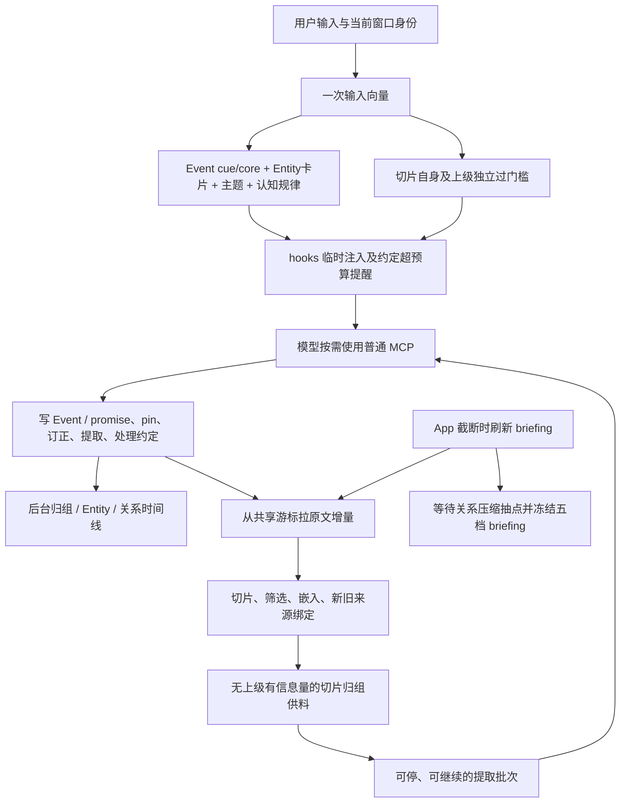

# Ember 记忆生命周期

Ember 的记忆写入、召回、后台维护、提取和 briefing 流程。

## 1. 职责与时机

Ember 提供 MCP + hooks，负责记忆、来源、召回及后台维护；App 持有对话循环、实际上下文和截断编排。跨边界的材料交换是 briefing 与 App 原文服务，工具和召回分别经 MCP、hooks 交付。App 的 Sleep 只做梦和写信；信的正文和版本都归 App，Ember 不参与。

普通轮次不重拼 briefing；新会话、截断、断线重进需要新简报时显式 refresh。后台模型失败保留待办或重试期限。模型按用途从 config/models.json 取配置，统一调用 model_gateway.call_model；数值阈值和预算集中在 config/lifecycle.json，可用 EMBER_LIFECYCLE_CONFIG 指定替代文件。

## 2. Event 写入、冷静期和取代

write_event 与 write_promise 并排提供。event 的内容字段为 summary、core、整数 significance、kind、focus。情况、理解、细节和感受写进 core。write_event.kind 为 daily / relationship / project；write_promise.kind=promise，另有 due，初始 status=open、log=[] 由系统生成。

来源二选一：quote_spans（起尾原话，允许多个分离区间）或 source_slice_ids。模型填写的 focus 是来源中的逐字原话，按 quote 相同的匹配方式解析为内部消息 ID，供 pin 居中截断；不向模型展示 ID。找不到或歧义时给 event.focus 字段与重摘提示，不猜来源。

revise_memory_event 只在原文完整保留于实际当前上下文的冷静期内修改；截断后永久锁定，后来下钻或召回不解锁。所有 kind 一样；拒绝提示为“已过冷静期，不能修改；写一条新的 Event 取代它（关系事件写一件新的接在后面）”。来源绑定不可改。promise 的状态、due、追加 log 交 process_promise。

write_event / write_promise 可附 supersedes（旧 Event ID 数组），保留原文及旧 Event、标 superseded_by 与取代关系并退出自动召回，主动查询仍可达。新旧任一端为 relationship 均拒绝；未知目标在写入前拒绝。关系只接续新事。

## 3. 切片及自动召回

一批 Event 写入后后台拉增量；briefing refresh 再同步拉一次兜底。二者共用持久游标，排他推进，只在该页切片、筛选、嵌入和绑定成功后确认。失败不前移，内容身份幂等。turn_end 记录来源及生成终态。App 提供已完成的精确人机对，系统来源用户条显式排除，只留下 assistant 条。

| 切片类别 | 处理 |
|---|---|
| 有上级 Event | 绑定来源，不独立呈现原文；自身向量和上级 core 分别过门槛才带出上级 |
| 无上级、有信息量 | 单独参与原文召回，也进入提取上游归组 |
| 无上级、无信息量 | 不存向量、不进召回池；App 原文不删除 |

无上级切片先过长度/语气词规则，再比同空间典型废话向量；有上级的切片不做这层信息量清除。新切片查已有区间；新 Event 回盖旧切片时补绑，不重算原向量。一个切片可有多个上级，分别判断。上级被取代、订正或低分约定完结时，该入口关闭；仍有可召回上级时照常。

| 上级 | 切片入口 |
|---|---|
| daily 高分或尚未聚合低分 | 带原 Event |
| daily 低分且已被主题替换 | 比原 core，带主题概括 |
| promise 高分或低分 open | 带约定 |
| promise 低分已完结 | 关闭 |
| project / relationship | 关闭 |

输入只算一次 embed 查询向量，core / cue / 切片 / 主题复用该空间。recall_embed 主动检索索引使用独立命名空间，不能混比。切片候选仍有独立 rerank。来源完整在实际当前分支的材料不重复自动呈现；未知来源保守保留。Event 主席最多三件，Entity summary 不占席；现行持续在场最多三轮，不召回、取代、现场与 pin 等资格可提前终止。临时注入不写成聊天历史。

召回 trace 用于诊断。第三方切片归组仅为提取工具供料。

## 4. 共用归组、主题和 Entity

Event 后台共用一套“向量候选 + LLM 判断”：一类事进入主题，具体对象进入 Entity。daily / promise / project 可挂 Entity；relationship 不提 Entity。

低分日常先复制进不可变聚合池；同类够数后用全部副本客观重概括，替换自动召回中的零散 Event，原件保留。低分完结约定形成独立的客观主题概括，和正式认知/规律分层；原约定不再自动召回。

Entity summary 标注“根据相关事件客观整理”，由后台写。项目按新事实重写现状，旧状态退出 summary；人、动物、地方只增补。先匹配现有对象，确定同一对象才复用并加别名；拿不准不合并。只对新建、别名或 summary 变化的卡片查重，保留较早主卡片、别名及成员，旧 ID 映射可用。模型可用 revise_entity_summary 直接订正。

输入只命中 Entity 名称/别名时，仅给 summary；命中 Event 时附其全部所属 Entity summary，卡片一次一份，不带整区域 Event。read_entity_events 下钻成员。共享 recall_embed 嵌入和向量帮助函数位于 recall_embedding.py。

## 5. 关系时间线与 pin

关系按实际发生时间排序，三档为原样 → 逐件压缩 → 按批要点。写入即缓存压缩版，pin 的也压；超过上下限从早到晚换压缩版，再对压缩区按批抽点。要点只追加新文字或“后来……”，不重写已有文字；重复事实可补来源。每条要点保存 Event ID 和可分离时间区间，briefing 只给文字；read_relationship_point 返回底下的 Event 和时间。

只有原文已不在当前窗口的 Event 能抽点，抽点后持续锁定。订正尚未抽点的 Event 只重压这一件。已抽点后再 pin 时，要点不作废，该 Event 在自己的位置额外出现原样及原文；unpin 撤去额外原样。关系只挂 continues / responds_to，不取代、不提 Entity。

后台用独立持久待办处理关系写入、关系 pin 变化、到点重试；启动只恢复扫描一次，空闲 tick 不全量 synchronize。待办版本防止处理中新增写入丢失。briefing refresh 等待未完成压缩与抽点；模型重试仍失败则保留准确的原样/压缩版并报告健康提示，允许暂时超预算。压缩和要点占比达到 timeline.health_ratio 时提示调高时间线预算。

pin 分 relationship、ordinary、knowledge 三个限条数类别，加一个不限条数、按字数提醒的 10 分无 due promise 类别。满额返回类别清单和先 unpin 提示。list_memory_pins 读清单。Event 原文围绕 focus 消息居中取 event_chars，省略两端标“前面还有/后面还有”；下钻返回完整原文。knowledge 有单条长度保护。

merge_memory_events 只合并 10 分无 due 的同义约定，保留最早一条，重写 summary/core，追加合入 log，合并真实来源且不把跨会话来源伪造为连续 span；旧条保留 merged_into 与别名映射。超字数预算经 hooks.system_reminders 只提醒一次，回到预算内后再次超额才再提醒；快照提交成功才确认提醒已送出。

## 6. promise 与 briefing

promise 有 status=open / done / dropped / lapsed、due 和追加 log。到期 open 约定在 briefing 最后常驻；未来 due 或无 due 只按线索浮现，10 分无 due 写入时默认 pin。低分完结退出自动召回并进主题池；高分完结保留通常记忆资格。

未 pin 的约定经 briefing、cue、召回真正进上下文才记曝光。list_pending_promises 返回尚未处理约定及曝光时的确切对话原文，完成回复只按同 generation 已接受身份补齐，不用最大回复号推断。process_promise 必须写非空 log，状态不变也写；可置 done / dropped 或更新 due，写完才确认曝光。未确认的下次仍在，持久日志可恢复中断回执。

钉住的约定从所有入口均不记曝光、不计待处理；可主动 process_promise，无需曝光，log.spans 可为空。每日本地午夜（默认 Asia/Shanghai）把 due 满 lapse_days 且仍 open 的约定转 lapsed、写 log；启动补算，时区不取服务器默认值。

briefing refresh 保存完整冻结快照，GET 只读快照，普通轮次不动态替换：

| 顺序 | 内容 | 预算与呈现 |
|---|---|---|
| 1 | 关系时间线，含关系 pin | 按时间线三档；pin 在自己的位置给原文 |
| 2 | 其余 pinned Event / promise | 原文，按 pin 规则 |
| 3 | 新写 72 小时内非关系、非 promise | 8–10 分 core，1–7 分 summary，剩余预算从低分/较旧砍 |
| 4 | pin 的认知/规律 | 正文及单条长度保护 |
| 5 | 到期 open 约定与待处理条数 | 不砍；0 条不显示提示 |

现场原文完整在上下文的 Event 不进。未 pin 的 10 分不永久常驻；72 小时内仍进近期 core 层。失败、超预算、source_sync 状态如实返回；快照有 revision 和 refreshed_at，损坏不会伪造空成功。

## 7. 随时调用的提取工具

后台只对无上级、有信息量且 ready 同空间向量的切片，按向量候选交 slice_groups 模型归组；模型只给说明，不正式提炼认知/Event。失败按种子切片版本记录次数及重试期限；退避期内将该切片从种子和候选中跳过，先处理后续切片，到期再试。指数退避的初始时间、上限和连续失败告警次数由 extraction 配置控制。成功、来源变化或切片已处理后清理对应记录；只读健康检查报告连续失败。来源版本改变时撤回旧提取材料；切片被正式写入使用后自动结账，其他新增上级覆盖的切片退出候选。

get_memory_extraction_batch 返回最早的组、组内原文、相似已有认知/规律。整组能独自放下时不拆；本批放不下留下一批。只有单组独自超限才按 material_fragment 分段，offset 连续，拼接后是完整 JSON 材料，无文字损失。批次材料数组按 JSON 字符数受 batch_chars 限制，返回未交付的 remaining_groups / remaining_chars；模型自主决定继续或停。

write_event / write_promise / write_memory_knowledge，以及认知/规律 rewrite / merge 带来源切片 ID 时，成功后系统自动按切片版本结账，记录结果 ID。只用一组中的部分切片时，其余切片保留在原组并继续供料；全部结掉后完成组。正式产出先落库而队列更新中断时，可从持久来源关联恢复结账。

finish_memory_extraction_group 只用于决定不写的材料：整组、指定 source_slice_ids，或已交付的超限 part_id。已完成或已撤出的组返回 ok，不存在的组报错。未写入且未跳过的材料重启后仍在。普通 MCP 工具不需要再报 written / merged。

审阅使用已交付提取组的相似知识清单，维持、改写、合并须覆盖全部清单。最终保留项均评分，低置信度只能凭近期打破或过时的逐字来源证据；来源版本及身份校验保留，低置信度退出自动召回和 pin。正式认知/规律由当前模型写，第三方归组与客观 Entity/主题摘要不替代正式作者。

## 8. 接口与运行边界

POST /ember/sleep/knowledge/start|tool|finish、link 和 structure 入口返回 410 legacy_sleep_step_retired，没有写入副作用。POST /ember/sleep/sediment/evidence 返回 410 legacy_sediment_evidence_retired，没有写入副作用。做梦和写信由 App 管理，Ember 不关联信与 Event，也不维护证据账本。

HTTP / MCP、原文精确 path 和增量流、调用身份和失败码见 API.md；快照、引用、主动 run 等稳定协议见 PROTOCOL_DETAILS.md。原文/提取/待处理约定等工具正文使用易失回执，持久调用账不复制这些原文。后台缓存和来源副本仍保存在实例目录，是派生材料，不等同于新写聊天历史。

模型 key 仅在 .env，对应 purpose、账号和向量空间独立。接入方提供原文精确路径和增量接口，消费 hooks 的召回与提醒输出。
