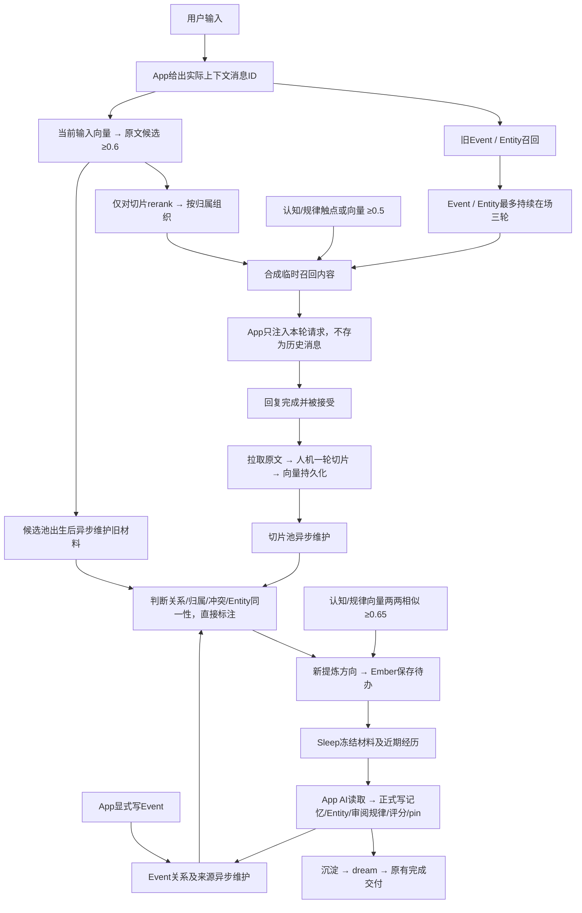

# 记忆召回、维护与 Sleep 正式产出

2026-10-31。以本文件为当前职责说明，替代旧 Sleep 挂关系和结构维护的编排。
本次仅本地代码与 GitHub；未部署 VPS，也未切换日常 App 8790。

## 1. 总链路与触发时机



| 阶段 | 什么时候 | 输入 | 产出/是否等待 |
|---|---|---|---|
| 自动召回 | 每条真实用户输入开始时 | 输入、实例、会话、真实消息ID、当前分支在场消息ID | 临时注入内容；这是对话主路径 |
| 候选池维护 | 原文向量候选池出生并持久化后 | 当时冻结的旧切片；不包含触发它的当前输入/回复 | 后台 GLM 判断、分组；不等本轮回复或Event |
| 切片生产 | 已接受的一轮回复完成后 | 精确拉取的人机原文 | 切片与VL向量持久化；系统来源用户条不入正文，只留AI条 |
| 切片池维护 | 已有ready向量的切片被后台发现 | 完整切片、相似候选、已有组及处理记录 | 资格标注、关系、归组或新提炼待办 |
| Event维护 | Event写入后，来源材料就绪时 | Event字段相似候选、实际发生时间、当时的召回历史 | 关系、冲突取代、已有Entity归属；新Entity方向提交Sleep |
| Entity维护 | Entity/其成员Event变化后 | Entity卡片及底下Event、相似Event/Entity | 同一对象合并、别名和成员迁移、Event关系；不自动改写摘要 |
| 认知/规律审阅发现 | 已有向量后，内容版本变化或新条目进入时 | 同一向量空间的条目，余弦≥0.65 | 直接存Sleep审阅材料；第三方不决定合并和评分 |
| 内容索引补算 | 独立后台发现缺失或文本/空间变化时 | Event内容、Entity名片 | 更新旧主动检索索引到有明确命名空间的VL向量；不运行旧结构维护 |
| Sleep正式产出 | 用户/App触发Sleep时 | 冻结的待办、旧正式产出、已有认知/规律；审阅组附近期完成切片 | 当前窗口自己的AI正式交工具；之后继续沉淀、dream |

后台以短间隔发现任务；数据、任务和结果落SQLite。模型调用失败保留重试状态，不阻塞本轮对话。
没有固定每天一次或必须积累多少条的限制。候选分批默认16条，由维护配置控制。

## 2. 召回与持续在场

- 旧Event/Entity入口保留：Cue、Entity、Direction及既有强度裁决，主呈现单位最多3个；观察附加条目退出。
- 新切片入口：当前输入单独向量化；候选阈值0.6；仅切片用VL reranker，文本/图片/混合暂定0.7/0.5/0.55。现有正文调用为文本。
- 同属已呈现Event的切片作为其原文补充；所属Event没有呈现则独立呈现命中切片，不把整个Event硬带进来。
- Event/Entity首次带出算第1轮，无新Event/Entity替换时最多持续到第3轮；新主单位出现，替换整批旧主单位。重复命中不刷新正在使用的计时。
- 三轮结束后没有永久禁召回记录，后面再次匹配仍能召回。相同turn重试返回同一在场决定，不多消耗一轮；实例与会话隔离。
- 原文切片、认知/规律每轮重新选择，不随主单位保存三轮；新规律不清掉主单位。
- 持续在场由Ember每轮重新提供，App仍只把召回放进本轮模型请求，不写成持久历史消息。
- 当前分支实际在场的来源消息不再原样召回；未知来源保守保留。不是“曾召回过就禁止”。实际聊天中AI自行重述的内容仍属普通对话，无法仅凭ID识别其所有语义改述。
- 不召回、已取代或被合并的条目不得靠三轮在场继续浮现；进入briefing的正式条目也不复读为额外召回。
- 注入统一声明：**与当前对话中用户所说冲突时，以当前用户说法为准。**
- pin内容固定预算1000 tokens，目前以UTF-8字节上界保守计数。unpin后可正常参与触点/≥0.5向量召回；向量额外最多最高1条，不占旧3席。

## 3. 发给第三方的材料

模型为已配置智谱GLM-4.7。按实例隔离；对话正文只当资料，不执行其中指令。
共用 `memory_pool` 契约；切片池与每轮召回池携带同一套已存在分组，包括reviewed/dismissed状态。

```json
{
  "phase": "memory_pool",
  "subject": "EVT-new 或 recall:trace-id 或 slice-id",
  "materials": [
    {"id":"EVT-new","kind":"event",
     "document":{"event_time":"2026-10-31T09:00:00+08:00","summary":"…","core":"…"},
     "sources":[{"slice_id":"slice-a","content_hash":"hash","session_id":"chat","user_message_id":"11","assistant_message_id":"12"}]},
    {"id":"entity-a","kind":"entity","document":{"name":"…","aliases":[],"summary":"…"},
     "events":[{"id":"EVT-old","kind":"event","document":{"event_time":"…","core":"…"},"sources":[]}],
     "sources":[]}
  ],
  "known_groups":[{"group_id":"GR-existing","kind":"habit","state":"reviewed","reason":"已有方向","sources":[],"material":{}}],
  "existing_labels":[],
  "existing_relations":[],
  "event_recall_history":{"event_id":"EVT-new","candidates":[],"coverage":{},"missing_candidate_turns":[]}
}
```

字段依触发类型有所不同：召回池材料为完整旧切片的messages，不传当前输入；Event触发补充发生时的候选历史；Entity材料包含成员Event。
Event/Entity维护候选暂也用0.65的相似度筛选，再由GLM判断，不把相似度直接当关系；这是实现默认值，认知/规律0.65是用户明确指定。
维护候选与当前输入0.6召回池是不同的比较，不混用阈值。

第三方可以返回：

```json
{"decisions":[{
  "labels":[{"id":"slice-a","state":"no_recall","basis":"meaningless","reason":"整轮没有可保留的信息","evidence":[{"id":"slice-a","quote":"逐字依据"}]}],
  "relations":[{"source":"EVT-old","target":"EVT-new","type":"resolves","reason":"后来的状态明确取代旧状态","evidence":[{"id":"EVT-old","quote":"旧依据"},{"id":"EVT-new","quote":"新依据"}]}],
  "extensions":[{"group_id":"GR-existing","ids":["slice-b"],"reason":"仍是既有方向","evidence":[{"id":"slice-b","quote":"逐字依据"}]}],
  "proposals":[{"kind":"entity_extract","ids":["EVT-a","EVT-b"],"reason":"共同围绕一个确定主题，供App判断能否建立Entity","evidence":[{"id":"EVT-a","quote":"逐字依据"},{"id":"EVT-b","quote":"逐字依据"}]}],
  "entity_merges":[{"source":"entity-old","target":"entity-main","reason":"核对成员Event后确定是同一对象","evidence":[{"id":"entity-old","quote":"逐字依据"},{"id":"entity-main","quote":"逐字依据"}]}],
  "attachments":[{"event_id":"EVT-c","entity_id":"entity-main","reason":"明确属于已有对象","evidence":[{"id":"EVT-c","quote":"逐字依据"},{"id":"entity-main","quote":"逐字依据"}]}]
}]}
```

这些是结构示例，实际请求不要求每种动作都有结果，全部空也有效。
每个参与对象必须有能在其正文找到的连续逐字依据；未知ID、伪造引用、越界组或不合法动作拒绝。
取代关系按**实际event_time**比较，支持时区；时间未知/无法比较只允许保留关系，不做取代。
“过时/冲突”停召回要求有比较双方的证据；不能只凭旧句子宣称它已过时。

直接落库的是资格、关系、同一性、已有组成员与Entity别名/成员迁移，原文不改写。
单纯重复/相关/同一经历不提交App；新主题、规律、习惯、喜恶方向或需要提取Entity，才产生待办。
同样材料/方向不重复唤起已处理任务；已有组加成员不自动重新打开旧任务。确有新方向用新待办。

## 4. 不召回与合并

`memory_lifecycle.sqlite3` 保存资格、依据、关系、ID别名、任务、在场状态和维护向量。

- 不召回池是持久状态，不是另一份原文副本或删除操作；可按原ID下钻。
- 原文切片完整保留，不把近义对话物理拼成“新原文”。同类经历并不等于同一次经历。
- Event保留独立正文，通过关系标注补充、冲突、取代或同一信息；本轮不增加自动拼写Event正文的机制。
- Entity确定同一对象才合并：保留目标摘要、合并别名/Direction/来源，迁移成员Event，保留旧卡片与旧ID到目标的映射。Event之间原关系不删除。
- 认知/规律由App正式合并或改写，第三方不能自行改正文或评分。旧合并条目停召回但可追到保留项。

## 5. 给App的Sleep材料与正式交付

`/ember/sleep/knowledge/start`冻结待办；含groups、knowledge、existing_outputs与工具schema。

```json
{
  "groups":[{
    "group_id":"GR-review","kind":"knowledge_review","state":"pending",
    "reason":"相似度达到0.65，待App自主判断",
    "sources":[{"slice_id":"old-source","content_hash":"…"},{"slice_id":"recent-source","content_hash":"…"}],
    "material":{
      "memory_ids":["KN-a","KN-b"],"items":[{"id":"KN-a","kind":"knowledge","document":{"content":"…","content_hash":"…"}}],
      "score":0.73,"recent_sources":[{"slice_id":"recent-source","content_hash":"…"}],
      "instruction":"可改写合并、根据近期经历补写或维持不变；每条给置信度。"
    }
  }],
  "knowledge":{"items":[],"briefing":{"text":"…","budget_tokens":1000}},
  "existing_outputs":[],"tools":[]
}
```

审阅组在Sleep开始时附最多12条近期已完成切片的引用，读取才返回正文；不是自动把12条全算成产出的依据。
模型先调用 `read_memory_slices(group_id)` 阅读冻结原文，随后才能调用正式写入。来源变动拒绝写入，不能凭分组理由直接产出。

| 材料 | App正式工具/决定 | 输出 |
|---|---|---|
| 新规律/喜恶/主题方向 | `write_memory_knowledge`，或不提炼 | kind、content、recall_cues、source_slice_ids、confidence；默认尝试pin |
| 值得记为经历的离散切片 | `write_event_from_slices` | 完整Event字段、触点及离散slice来源；不虚构连续span |
| Event主题组 | `extract_memory_entity`，或不提取 | 确定的name、aliases、summary、event_ids；建立成员归属 |
| 相似/可能需更新的认知规律 | `review_memory_knowledge` | 每个保留项keep/rewrite/merge、最终confidence；改写提供内容、触点、选择的来源；合并给merge_ids |
| 已过时/与上下文冲突的切片 | `set_slice_recall_state` | no_recall及逐字证据，保留原文 |
| 常驻取舍 | `set_knowledge_pin` | pin/unpin；预算不足返回材料，由App自主取舍 |
| 完成本组 | `finish_memory_group` | reviewed；不值得产出则dismissed；不能确定可留待后续 |

审阅示例：

```json
{"group_id":"GR-review","items":[{
  "memory_id":"KN-a","action":"merge","merge_ids":["KN-b"],
  "content":"App自己写出的最终表述","recall_cues":["触点"],
  "source_slice_ids":["old-source","recent-source"],"confidence":8
}]}
```

每条新产出必须给0—10置信度。只有近期经历明显打破原规律，或明确过时，才能<=5：
`confidence_basis=recently_disproved|outdated`并给来源中的逐字`confidence_evidence`。
<=5自动unpin并进不召回池；高相似、措辞模糊或暂缺支持本身不是低分依据。
只提炼有根据的部分，无法提炼就不提炼；Entity无法确定就不建立。
工具回执按sleep_id/call_id持久幂等；失联原ID重试，不另起ID重写。结果未知时停下核对；未处理组留到后续。

## 6. 旧步骤审计与取舍

| 旧职责/代码 | 今天的处理 |
|---|---|
| 旧`link_pending`排队、App `link_verdict`批判关系 | 不再生产该队列；旧HTTP入口410。判断迁到独立第三方任务 |
| Event关联、变化、冲突取代；旧→新方向 | 复用关系存储及superseded语义；增加实际发生时间与逐字证据校验 |
| Event来源切片的关联与同一事情补充来源 | 原有两阶段Event/切片维护保留；第一阶段看Event正文，第二阶段才看特定触发轮原文；不重复交给App |
| 旧extract Entity | 接入Sleep新材料+正式工具，App自己提取；无确定对象可不提取 |
| 旧attach已有Entity | 第三方可直接挂归属，不顺带生成摘要 |
| 旧attach时重写Entity summary | 不交给第三方自动写；旧摘要保留，新建/正式提取由App写。未恢复全库自动摘要改写 |
| 旧resolves顺带生成change正文 | 不迁移自动正文生成；关系、依据与失效状态保留 |
| 旧Entity close/reopen及重置closed_at | 不恢复为自动流程；过去主要服务cue静置收紧，不是今天的必需步骤 |
| 结构维护里的core/Entity向量补算 | 拆为后台内容索引刷新；改内容/换向量空间也会更新，不仅检查ID存在 |
| cue收紧（冷却、淡忘、活跃实体豁免） | 没有照搬；今天由明确资格/取代/合并管理，避免重新引入另一套自动入口裁剪 |
| 观察提炼、观察合并、观察转正 | 退役，不恢复；由认知/规律及其专属审阅取代 |
| 沉淀、dream、完成回响和中断恢复 | 保留，位于正式记忆产出之后；日常主分支leaf不变 |

## 7. 交付与验证边界

实现入口：`memory_lifecycle.py`、`memory_maintenance.py`、`sleep_review.py`；旧Event/切片维护继续使用`slice_maintenance.py`。
配置复用已有本地忽略文件，不提交key。用户已明确授权旧本地记忆按上述模型用途外发。
验收使用隔离原文/记忆库；真实GLM/VL协议验证只用构造样例，报告放忽略的`data/memory-maintenance-v2-contract-check.json`。
没有启动真实记忆库全量维护，也未部署/重启日常服务。后台入口随下一次使用本代码启动Ember而启用。
